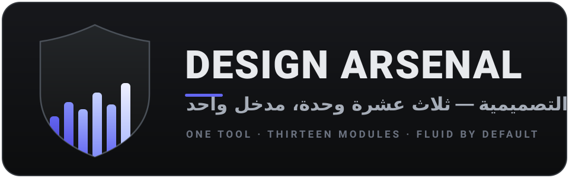

<p align="center">
  
</p>

# 🏰 Design Arsenal — الأداة الموحّدة لتصميم الواجهات

> **أداة واحدة، ثلاث عشرة وحدة، مدخل واحد — سير عمل كامل للواجهات الأمامية.**
> استخرج نظام التصميم، اتجّه بذوق مضاد للقوالب الجاهزة، صقِل وانتقد وحسّن، حرّك بـ GSAP، اسحب مكوّنات React متحركة، أضف انتقالات CSS إنتاجية، ابنِ واجهات عربية RTL سليمة، طبّق بوابات الإتاحة (WCAG)، ولّد Design Tokens بمعمارية متدرجة، أدِر أداء Core Web Vitals، ابنِ وضعًا داكنًا خاليًا من الوميض، اجعل التخطيط سيّالًا متجاوبًا على كل الشاشات، ثم اختبر كل شيء في متصفح حقيقي — كل ذلك من أداة واحدة يقرأها وكيلك البرمجي مباشرة.

---

## 📖 نظرة عامة

**Design Arsenal** ليست مجموعة أدوات متجاورة، بل **أداة واحدة حقيقية** تدمج سبعة مشاريع مفتوحة المصدر تُعد الأفضل في مجالها (منسوخة من مستودعاتها الأصلية) **مع ست وحدات أصلية authored خصيصًا لهذه الحزمة** (العربية وRTL، الإتاحة، Design Tokens، الأداء، والوضع الداكن، والتجاوب السائل) لتصميم الواجهات بواسطة وكلاء الذكاء الاصطناعي (Claude Code، Codex، Cursor، Gemini CLI، Windsurf، OpenCode). المشكلة التي تحلّها معروفة لكل من جرّب هذه الأدوات منفردة: كل أداة تُثبَّت على حدة فتظهر عند الوكيل كأدوات كثيرة متداخلة المشغّلات، ولكل منها أسلوب استدعاء مختلف، والوكيل لا يعرف أيّها يقرأ متى. الحل هنا جذري: **ملف `SKILL.md` واحد فقط** في الحزمة كلها — تُنصَّب أداة واحدة باسم `design-arsenal`، وتقرأ الأداة أدلة الوحدات الداخلية (`MANUAL.md`) من القرص عند الحاجة فقط، فلا تتضخم حزمة المهارات ولا سياق المحادثة.

> **جديد في v2.4.1:** تجديد شامل للديمو — **مختبر السوائل** التفاعلي في `demo/showcase.html` (منزلق viewport يحسب حجم `clamp()` لحظة بلحظة ويولّد قاعدة CSS جاهزة للنسخ بنفس صيغ `responsive §3`)، قائمة موبايل وصولية (disclosure بـ `aria-expanded`) بدل إخفاء التنقّل، تمييز القسم الحالي في التنقّل (scroll-spy)، الشعار الرسمي وfavicon في الصفحتين، ربط ثنائي الاتجاه بين `index.html` و`showcase.html` مع شريط «الوحدات الأصلية الست»، focus-trap كامل لمودال العرض، ومزامنة كل العدّادات (13/6/5 + محظورات responsive الثلاثة) إلى v2.4.1.
>
> **جديد في v2.4.0:** الوحدة الأصلية السادسة **responsive** — نظام تجاوب سيّال أولًا (fluid-first): تايبوغرافي وتباعد وشبكات تتمدد قبل نقاط التوقف، و`clamp()` بصيغ جاهزة، وشبكات `auto-fit` بلا استعلامات، واستعلامات حاويات للمكوّنات، ووسائط `srcset`/`aspect-ratio` + فاحص بلا اعتماديات (`responsive.mjs`) يكشف viewport المفقود أو المقفول، وخط `px` على الجذر، والعرض الثابت والـ`100vw`، وCSS بلا سلاسة + **الشعار الرسمي** في `logo/` + **ديمو حي عبر GitHub Pages**.
>
> **جديد في v2.3.0:** الوحدة الأصلية الخامسة **dark-mode** — معمارية الثيم الداكن كطبقة رموز (داكن-بملف)، قواعد إعادة الضبط بدل القلب الميكانيكي، مفتاح ثلاثي الأوضاع بلا وميض (سكربت الإقلاع الجاهز)، + فاحص بلا اعتماديات (`theme.mjs`) يكشف التجاوزات الناقصة والوهج والقيم الثابتة ويفحص تباين الثيمين معًا + الديمو التفاعلي `demo/showcase.html` + إصلاح حماية `examples/workflows/` في مزامنة CI الشهرية.
>
> **جديد في v2.2.0:** الوحدة الأصلية الرابعة **web-vitals** — عتبات Core Web Vitals (LCP/INP/CLS) وخط لعب تحميل الموارد + محلل HTML ثابت بلا اعتماديات (`webvitals.mjs`) يكشف قاتلات الأداء البنيوية قبل النشر + حماية CI موسّعة ومثال workflow رابع.
>
> **جديد في v2.1.0:** شجرة قرار من أربعة أسئلة في `SKILL.md` + سجلّ anti-patterns عابر للوحدات + ثلاث وحدات أصلية جديدة (rtl-arabic، a11y، design-tokens) بسكربتات قياس حقيقية + أوامر `doctor` و`update` في المثبّت + 3 أمثلة end-to-end في `examples/workflows/`.

بنية النظام:

```text
وكيلك  ←  أداة واحدة  (design-arsenal / SKILL.md)
                 ├── EXTRACT      استخراج أنظمة التصميم
                 ├── TASTE        التوجيه الفني المضاد للقوالب
                 ├── BUILD        المكوّنات الجاهزة + Design Tokens
                 ├── MOTION       وحدتا الحركة (GSAP + transitions)
                 ├── POLISH       الصقل والمراجعة
                 ├── VERIFY       التحقق بالمتصفح
                 ├── RTL عربي     طبقة سياق لأي محتوى عربي
                 ├── A11Y         بوابات الإتاحة على كل مرحلة
                 ├── WEB VITALS   ميزانية أداء على كل مرحلة (LCP/INP/CLS)
                 ├── DARK MODE    طبقة الثيمات مع design-tokens (فاتح/داكن)
                 └── RESPONSIVE  طبقة سائلة لكل viewport (clamp + auto-fit + container queries)
```

سير العمل الكامل الذي تغطيه الأداة:

```
EXTRACT  استخرج  →  TASTE  وجّه  →  BUILD  ابنِ  →  MOTION  حرّك  →  POLISH  صقِل  →  VERIFY  تحقّق
```

| المرحلة | الوحدة | ما تفعله عمليًا |
|---|---|---|
| استخراج | **extract** (designlang) | يشغّل متصفحًا بلا واجهة على أي رابط ويقرأ نظام التصميم كاملًا: رموز DTCG، إعدادات Tailwind، ثيم shadcn/ui، متغيرات Figma، درجات WCAG، وملفات جاهزة للصق في v0/Lovable/Cursor |
| توجيه | **taste** (Taste Skill v2) | يقرأ موجز المشروع ويستنتج الاتجاه الفني (الفكرة، التكوين، الخط، اللوحة، حركة العمق) من مكتبة مدروسة من 247 موقعًا حائزًا على جوائز، مع حظر صارم لـ«AI slop» |
| بناء | **components** (React Bits) | 218 مكوّن React متحرك جاهز (خلفيات، نصوص، تأثيرات دقيقة) بنكهتي TS-CSS وTS-Tailwind |
| حركة | **motion/gsap** (GSAP، 8 وحدات فرعية رسمية) | التحريك المتقدم: timelines، ScrollTrigger، الإرساء، الأطر، الأداء، React وغيرها |
| حركة | **motion/transitions** (Transitions.dev) | أكثر من 43 انتقال CSS إنتاجية جاهزة (مودالات، توستات، شارات، حالات تفكير الذكاء الاصطناعي…) مع رموز حركة موحّدة |
| صقل | **polish** (Impeccable) | 24 أمر تصميم احترافي (`polish`، `audit`، `critique`، `bolder`، `quieter`، `typeset`…) وقواعد كشف حتمية ضد الأنماط الرديئة |
| تحقق | **verify** (Playwright CLI) | أتمتة المتصفح بكفاءة توفير الرموز: لقطات شاشة، تصفح، فحص تدفقات، تسجيل فيديو، تتبع أخطاء |
| عربية/RTL | **rtl-arabic** (أصلية) | الخصائص المنطقية بدل left/right، تايبوغرافيا عربية (حظر letterspacing، ارتفاع السطر)، الأرقام والعملات، قلب الأيقونات وحركة GSAP، تدقيق من 10 نقاط |
| إتاحة | **a11y** (أصلية) | بوابات WCAG 2.2 AA قابلة للقياس: سكربت تباين بلا اعتماديات، HTML دلالي، 4 أنماط ARIA، لوحة المفاتيح، النماذج، حارس `prefers-reduced-motion`، تدقيق 12 نقطة قبل التسليم |
| أداء | **web-vitals** (أصلية) | عتبات LCP/INP/CLS وخط لعب التحميل (أولوية الـhero، حجز الأبعاد، defer الخطوط والسكربتات، facades) + محلل HTML ثابت بلا اعتماديات يكشف القاتلات البنيوية + جداول ميزانية وتدقيق 12 نقطة |
| رموز | **tokens** (أصلية) | من لقطة شاشة أو رابط أو موجز إلى معمارية DTCG متدرجة (primitives ← semantic ← component) مع مُحوّل إلى CSS وTailwind v3/v4 وFigma، ووضع داكن بملف واحد |
| ثيمات | **dark-mode** (أصلية) | إعادة ضبط الوضع الداكن بدل قلبه (سطوح ‎#121212، نص ‎#E6E6E6)، الثيم كملف رموز بمفاتيح موازية، مفتاح ثلاثي (فاتح/داكن/النظام)، سكربت إقلاع بلا وميض + فاحص `theme.mjs`: تجاوزات ناقصة، وهج ‎#fff/‎#000، قيم ثابتة، تباين الثيمين معًا |
| تجاوب | **responsive** (أصلية) | نظام سيّال أولًا: تايبوغرافي `clamp()`، شبكات `auto-fit` بلا media queries، استعلامات حاويات للمكوّنات، `srcset`/`aspect-ratio`، وحدات `dvh/svh` + فاحص `responsive.mjs` للـviewport والعرض الثابت والتجاوز الأفقي |

---

## 🚀 التثبيت

### الطريقة الأولى: السكربت الجاهز

```bash
# انسخ الأداة إلى جهازك ثم:
cd design-arsenal
chmod +x install.sh

./install.sh            # كشف تلقائي — يُنصّب أداة واحدة فقط باسم design-arsenal
./install.sh claude     # → ~/.claude/skills/design-arsenal
./install.sh codex      # → ~/.codex/skills/design-arsenal
./install.sh gemini     # → ~/.gemini/skills/design-arsenal
./install.sh cursor     # → ./.cursor/skills/design-arsenal (داخل مشروعك)
./install.sh windsurf   # → ./.windsurf/skills/design-arsenal
./install.sh opencode   # → ./.opencode/skills/design-arsenal
./install.sh project    # → ./skills/design-arsenal  (أي وكيل يقرأ SKILL.md)
./install.sh --dest /مسار/مخصص
./install.sh --list     # اعرض بنية الأداة الواحدة ووحداتها الثلاث عشرة
./install.sh doctor     # افحص سلامة الحزمة: المدخل، الأدلة، المسارات، السكربتات
./install.sh update     # حدّث نسختك: git pull إن كانت استنساخًا، وإلا آخر Release
```

بعد التثبيت **أعد تشغيل وكيلك** — سيسجّل **أداة واحدة بالضبط** اسمها `design-arsenal` — ثم جرّب طلبًا طبيعيًا مثل: «استخرج نظام التصميم من stripe.com».

### الطريقة الثانية: التثبيت اليدوي

انسخ مجلد الأداة كاملًا إلى مجلد المهارات الذي يقرؤه وكيلك، على أن يبقى ملف `SKILL.md` **الوحيد** في جذر المجلد — ملفات الوحدات الداخلية كلها باسم `MANUAL.md` فلا تُسجَّل كأدوات مستقلة:

- Claude Code: `~/.claude/skills/design-arsenal/`
- Codex CLI: `~/.codex/skills/design-arsenal/`
- Gemini CLI: `~/.gemini/skills/design-arsenal/`
- أي وكيل آخر: ضع الأداة داخل مشروعك وأشر إليها في إعداداته.

### المتطلبات الاختيارية لكل وحدة

| الوحدة | المطلوب | ملاحظة |
|---|---|---|
| extract | Node 20+ وPlaywright | يُثبَّت تلقائيًا عند أول `npx designlang <url>` |
| taste | Node فقط | سكربتاتها بلا أي اعتماديات خارجية |
| polish | لا شيء إضافي | سكربتات ثنائية مكتفية ذاتيًا داخل `skills/impeccable/scripts/` (وعلى Windows بلا `sh` استخدم `impeccable.cmd`) |
| motion/gsap | `npm install gsap` في مشروعك | الأدلة تعلّم الوكيل واجهة GSAP الكاملة |
| components | React 18/19 | المكوّنات محلية جاهزة للنسخ، أو سجّلها حيًّا (انظر أدناه) |
| motion/transitions | لا شيء | CSS خالص مع حارس `prefers-reduced-motion` |
| rtl-arabic | لا شيء | دليل معرفي بالكامل + Tailwind ≥3.3 للـlogical utilities |
| a11y | Node 18+ | لسكربت التباين (بلا أي اعتماديات خارجية) |
| tokens | Node 18+ | لسكربت التحويل إلى CSS/Tailwind/Figma (بلا اعتماديات) |
| web-vitals | Node 18+ | لمحلل HTML الثابت (بلا أي اعتماديات خارجية) |
| dark-mode | Node 18+ | لفاحص الثيمات `theme.mjs` (بلا أي اعتماديات خارجية) |
| responsive | Node 18+ | لفاحص التخطيط `responsive.mjs` (بلا أي اعتماديات خارجية) |
| verify | `npm install -g @playwright/cli` ثم `playwright-cli install-browser chromium` | أول تشغيل ينزّل Chromium (~100MB مرة واحدة) |

---

## 🧭 كيف يعمل التوجيه الداخلي؟

عندما يقرأ الوكيل `SKILL.md` الوحيد يجد **جدول توجيه** يربط كل نوع طلب بالوحدة الداخلية ومسار دليلها على القرص:

| تطلب المستخدم… | تُفعَّل الوحدة | دليل الوحدة (يُقرأ من القرص) |
|---|---|---|
| «استخرج التصميم من هذا الموقع» | extract | `skills/extract-design/MANUAL.md` |
| «ابنِ لي صفحة هبوط لا تشبه القوالب» | taste | `skills/taste/MANUAL.md` |
| «دقّق/صقِل/انتقد واجهتي» | polish | `skills/impeccable/MANUAL.md` |
| «حرّك هذا المشهد بـ GSAP» | motion/gsap (الوحدة المناسبة) | `skills/gsap/gsap-<module>/MANUAL.md` |
| «أضف مكوّن نص متحرك» | components | `skills/react-bits/CATALOG.md` |
| «اجعل المودال يفتح بسلاسة» | motion/transitions | `skills/transitions/transitions-dev/MANUAL.md` |
| «صوّر الصفحة واختبر التدفق» | verify | `skills/playwright-cli/MANUAL.md` |
| «ابنِ الواجهة بالعربية / اتجاه RTL» | rtl-arabic | `skills/rtl-arabic/MANUAL.md` |
| «اجعل التباين متوافقًا مع WCAG» | a11y | `skills/a11y/MANUAL.md` |
| «حوّل هذه اللقطة إلى Design Tokens» | tokens | `skills/design-tokens/MANUAL.md` |
| «صفحتي بطيئة / اجعلها تجتاز Core Web Vitals» | web-vitals | `skills/web-vitals/MANUAL.md` |
| «ابنِ/دقّق الوضع الداكن — بلا وميض عند التبديل» | dark-mode | `skills/dark-mode/MANUAL.md` |
| «اجعل التخطيط متجاوبًا / أصلح التجاوز الأفقي» | responsive | `skills/responsive/MANUAL.md` |

**قواعد فصل التداخلات** مدمجة في الأداة: بناء جديد ← `taste` أولاً؛ إعادة تصميم موجودة ← `polish` للتدقيق أولاً؛ تفاعل دقيق لعنصر واحد ← `motion/transitions` (أرخص وأبسط)؛ تماهد مشاهد كاملة أو تمرير ← `motion/gsap`؛ ملفات رموز آلية ← `tokens` (بينما موجز نصي من موقع حي ← `extract`)؛ **أي محتوى عربي** ← اقرأ `rtl-arabic` قبل أي CSS؛ سؤال الحركة مقابل الإتاحة ← قواعد `a11y` تسود دائمًا؛ سؤال الأداء ← محلل `web-vitals` الثابت أولًا ثم القياس الفعلي ولا يُخمَّن رقم أبدًا؛ الحركة مقابل الأداء ← ميزانية الخيط الرئيسي في `web-vitals` تسود (transform/opacity فقط)؛ طلب ثيم أو رموز ← `tokens` تبني المعمارية و`dark-mode` يفحص التوازية وينفّذ التبديل؛ سؤال الشبكة والتجاوب ← `responsive` يملك السلاسة ونقاط التوقف ويقسم العمل مع `web-vitals` (شكل الصورة مقابل تكلفتها) و`a11y` (تكبير WCAG 1.4.4)؛ وبعد أي تعديل على الواجهة يُقترح التحقق بـ `verify`.

وأضافت v2.1.0 قسمين في `SKILL.md` يوجّهان الوكيل مباشرة: **شجرة قرار من 4 أسئلة** (هل المحتوى عربي؟ هل المدخل تصميم قائم؟ هل المهمة إنشاء أم تعديل؟ بمَ تنتهي المهمة؟) و**سجلّ anti-patterns** يجمع المحظورات العابرة للوحدات (زر بـ`div onClick`، تباين دون 4.5:1، حركة بلا حارس reduced-motion، letterspacing على العربية، hex داخل المكوّنات…). وأضافت v2.2.0 أربعة محظورات أداء: `loading="lazy"` على صورة الـhero، وسائط بلا width/height، سكربت كلاسيكي حاجب في `<head>`، و`@font-face` بلا `font-display`. وأضافت v2.3.0 أربعة محظورات للوضع الداكن: القلب الميكانيكي للثيم (`#fff`↔`#000`)، والمفتاح الذي يومض عند إعادة التحميل (غياب سكربت الإقلاع)، والنص الأبيض النقي على الأسود النقي، والقيم الفاتحة الصلبة داخل المكوّنات عند وجود طبقة ثيمات. وأضافت v2.4.0 ثلاثة محظورات للتجاوب: viewport مقفول التكبير (`user-scalable=no` أو `maximum-scale` دون 2)، و`width: 100vw` على الحاويات (تمرير أفقي مع أي شريط تمرير عمودي)، و`px` على خط الجذر أو حاوية تخطيط ثابتة بعرض ‎480px فأكثر.

---

## 🧪 أمثلة استخدام عملية

### 1) استخراج نظام تصميم موقع منافس

```text
المستخدم:  استخرج نظام تصميم stripe.com وحوّله إلى ثيم Tailwind في مشروعي
الوكيل:    يقرأ skills/extract-design/MANUAL.md → ينفّذ npx designlang stripe.com
           ← يحصل على رموز DTCG + إعداد Tailwind + ثيم shadcn + درجات WCAG
```

### 2) بناء صفحة هبوط كاملة من الصفر

```text
المستخدم:  ابنِ صفحة هبوط لتطبيق تمويل شخصي، لا تشبه القوالب الجاهزة
الوكيل:    1. taste → يستنتج الاتجاه (لوحة، خط، عائلة تخطيط) ويطبّق الحظر
           2. يبني الصفحة، يسحب موجة نص من components (SplitText) إن ناسبت
           3. motion/transitions → انتقال مودال + حالة نجاح للنموذج
           4. polish → /impeccable polish ثم /impeccable audit
           5. verify → لقطة شاشة دسكتوب وموبايل للتأكد
```

### 3) صقل واجهة قائمة

```text
المستخدم:  واجهتي باهتة، اجعلها أجرأ لكن دون صراخ
الوكيل:    يقرأ skills/impeccable/MANUAL.md → يطبق bolder ثم quieter عند الحاجة
           → يكشف الأنماط الرديئة بقواعد الكشف الحتمية قبل التسليم
```

### 4) تحريك متقدم بالتمرير

```text
المستخدم:  أريد قسم storytelling يتقدم مع التمرير ويثبت ثم يتحرر
الوكيل:    يقرأ skills/gsap/gsap-scrolltrigger/MANUAL.md → pin + scrub + snap
           ويعود إلى gsap-react لو كان المشروع React (نمط useGSAP)
```

### 5) واجهة عربية RTL من لقطة شاشة (v2.1.0)

```text
المستخدم:  ابنِ لوحة تحكم عربية بالكامل تشبه هذه اللقطة
الوكيل:    1. tokens → يحوّل اللقطة إلى معمارية DTCG متدرجة ويفحص التباين
           2. rtl-arabic → خصائص منطقية، خط عربي مناسب، أرقام وسياسة عكس
           3. يبني الواجهة (مكوّنات من components حيث ناسبت)
           4. a11y → بوابات التباين والتركيز + حارس الحركة
           5. verify → لقطات RTL بالمحتوى المختلط (نص عربي + أرقام + اسم Latin)
```

### 6) صفحة بطيئة تفشل في Core Web Vitals (v2.2.0)

```text
المستخدم:  صفحة الهبوط بطيئة وLighthouse يقول إن CLS وLCP فاشلان
الوكيل:    1. web-vitals → يشغّل node skills/web-vitals/scripts/webvitals.mjs على الملفات
           ← يكشف: صورة hero بـ lazy + بلا أبعاد، سكربتات حاجبة في head، خط بلا font-display
           2. يطبّق خط لعب LCP (eager + fetchpriority) وحجز الأبعاد وdefer السكربتات
           3. يحدّد ميزانية أداء (JS ≤ 170KB مضغوط، صورة LCP ≤ 100KB...)
           4. verify → لقطات قبل/بعد مع جمع مؤشرات web-vitals في نفس الجلسة
```

### 7) وضع داكن بلا وميض لمنتج قائم (v2.3.0)

```text
المستخدم:  أضف وضعًا داكنًا لتطبيقنا — أريده يتبع النظام ومفتاحًا يدويًا، ولا أريد وميضًا أبيض عند كل تحديث
الوكيل:    1. tokens → يستخرج طبقة الرموز الدلالية إن لم توجد (سطوح/نصوص/حدود/علامات)
           2. dark-mode → يبني tokens.dark.json بمفاتيح موازية ويعيد ضبط السطوح والنصوص
           3. node skills/dark-mode/scripts/theme.mjs --tokens light.json --dark dark.json
           ← يكشف: تجاوزات ناقصة، قيمًا ثابتة، وهج #fff/#000، وتباينًا فاشلًا في أي ثيم
           4. ينفّذ سكربت الإقلاع بلا وميض + المفتاح الثلاثي (فاتح/داكن/النظام) مع إعلان الحالة للقارئات
           5. verify → لقطات للثيمين دسكتوب وموبايل + فحص التركيز في كليهما
```

### 8) تخطيط متجاوب سيّال على كل الشاشات (v2.4.0)

```text
المستخدم:  الصفحة تنكسر على الجوال ويظهر تمرير أفقي — اجعلها متجاوبة حقًا لا ترقيعًا
الوكيل:    1. responsive → node skills/responsive/scripts/responsive.mjs على الصفحات
           ← يكشف: viewport مفقود/مقفول، html بـfont-size px، width:100vw، عروض ثابتة، CSS بلا سلاسة
           2. يطبّق: إقلاع viewport سليم + تايبوغرافي clamp + شبكات auto-fit + container queries
           3. وسائط: srcset/sizes + width/height + aspect-ratio محجوز (بإشراف web-vitals على التكلفة)
           4. a11y → zoom 200% بلا تمرير ثنائي الاتجاه (WCAG 1.4.4)
           5. verify → لقطات عند 320/768/1024/1440px بالاتجاهين RTL/LTR
```

مشيّات end-to-end كاملة (المهمة ← الوحدات ← الأوامر ← النتيجة) في `examples/workflows/`.

---

## ⚛️ ربط React Bits بسجلّ حيّ (اختياري)

المكوّنات الـ218 مضمنة محليًا في `skills/react-bits/` بنكهتين، ويعرض `CATALOG.md` قائمتها كاملة. لجلب نسخ محدّثة دائمًا عبر سجل shadcn الرسمي أضف إلى `components.json` في مشروعك:

```json
{
  "registries": {
    "@react-bits": "https://reactbits.dev/r/{name}.json"
  }
}
```

ثم اطلب من وكيلك: «أضف مكوّن SplitText من react-bits» وسينفّذ:

```bash
npx shadcn@latest add "@react-bits/SplitText-TS-TW"
```

- مشاريع **Tailwind** → انسخ محليًا من `skills/react-bits/ts-tailwind/`
- مشاريع **CSS عادي** → انسخ من `skills/react-bits/ts-default/`

---

## 🎬 الديمو الشامل

افتح `demo/index.html` في أي متصفح — صفحة واحدة تعمل بلا أي اعتماديات بناء، تعرض عمليًا:

- **حركة GSAP** عبر CDN: تماهد دخول، عدّاد، stagger للبطاقات، وموجة نصية (محاكاة SplitText).
- **انتقالات transitions.dev** المستنسخة من الملفات المرجعية نفسها: مودال، توست، شارة إشعار، حالة نجاح، skeleton، حالة تفكير ذكاء اصطناعي (reasoning stream).
- **أنماط React Bits** معاد بناؤها في JS خالص: خلفية جزيئات، تدرج متحرك، GlareHover على البطاقات.
- **قواعد taste وpolish** مطبقة في التصميم نفسه: تباين صحيح، تدرج طباعي، لا بطاقات متداخلة، حارس `prefers-reduced-motion`.

استخدمه كمرجع بصري سريع قبل أن يطبّق الوكيل الأنماط في مشروعك الحقيقي.

### الديمو التفاعلي (v2.4.1)

افتح `demo/showcase.html` — عرض حيّ يطبّق مبادئ الأداة على نفسها: تبديل فاتح/داكن حقيقي بلا وميض (سكربت الإقلاع نفسه)، وقلب RTL/LTR بخصائص منطقية، و**مختبر السوائل** (منزلق viewport يحسب `clamp()` لحظة بلحظة ويولّد قاعدة CSS جاهزة للنسخ)، وفاحص تباين مباشر بنفس معادلات `contrast.mjs`، وشبكة الوحدات الثلاث عشرة بفلاتر، وشجرة قرار تفاعلية من أربعة أسئلة، ومعرض المحظورات الثلاثة عشر، وطرفية تثبيت بأزرار نسخ — مع قائمة موبايل وصولية وتمييز القسم الحالي أثناء التمرير. ملف واحد، صفر اعتماديات، عربي بالكامل — استخدمه لشرح الأداة لفريقك أو لتجربة قواعدها قبل تطبيقها.

الصفحتان متربطتان بروابط ثنائية الاتجاه: `index.html` (معرض الحركة) يعرض عمليًا ما تدمجه الوحدات الموروثة، و`showcase.html` (الاستوديو) يعرض الوحدات نفسها وقواعدها — وكل بطاقة من «الوحدات الأصلية الست» في الأول تفتح القسم التفاعلي المقابل في الثاني.

**يعرض الديمو حيًّا عبر GitHub Pages:** <https://cto-drs.github.io/design-arsenal/> — يُحدَّث تلقائيًا مع كل تغيير يُدفع إلى `demo/` على الفرع الرئيسي.

---

## 📁 بنية الأداة

```
design-arsenal/                  ← أداة واحدة، تُنصَّب مرة واحدة
├── SKILL.md                     ← مدخل الأداة الوحيد (اقرأه أولاً دائمًا)
├── index.json                   ← فهرس آلي للوحدات الثلاث عشرة
├── install.sh                   ← مثبّت ومدير (install / doctor / update / list)
├── ATTRIBUTION.md               ← الإسناد والتراخيص
├── logo/                        ← الشعار الرسمي (logo.svg + icon.svg) (أصلي v2.4.0)
├── demo/
│   ├── assets/                 ← نسخة الشعار للصفحتين (icon.svg + logo.svg)
│   ├── index.html              ← الديمو الشامل للحركة (معرض الأنماط الحيّة)
│   └── showcase.html           ← الديمو التفاعلي (ثيمات، RTL، تباين، مختبر السوائل) (أصلي v2.3.0)
├── examples/gsap/               ← أمثلة GSAP جاهزة (vanilla / react / vue / nuxt)
├── examples/workflows/          ← 6 مشيّات end-to-end بالعربية (أحدثها responsive في v2.4.0)
└── skills/                      ← وحدات داخلية (أدلة MANUAL.md لا تُسجَّل كأدوات)
    ├── extract-design/          ← extract: استخراج نظام التصميم
    ├── taste/                   ← taste: التوجيه الفني + مكتبة الاتجاهات + سكربتات فحص
    ├── impeccable/              ← polish: 24 أمر + 30+ مرجع + 4 وكلاء + سكربتات
    ├── gsap/                    ← motion/gsap: 8 وحدات فرعية + llms.txt
    ├── react-bits/              ← components: 218 مكوّن (نكهتان) + CATALOG.md + catalog.json
    ├── transitions/             ← motion/transitions: 3 أدلة + 18 مرجعًا
    ├── playwright-cli/          ← verify: الدليل + 10 مراجع
    ├── rtl-arabic/              ← عربية/RTL: الدليل الكامل (أصلية)
    ├── a11y/                    ← الإتاحة: الدليل + سكربت التباين (أصلية)
    ├── design-tokens/           ← الرموز: الدليل + محوّل multi-target (أصلية)
    ├── web-vitals/              ← الأداء: الدليل + محلل HTML الثابت (أصلية)
    ├── dark-mode/               ← الثيمات: الدليل + فاحص الوضع الداكن (أصلية)
    └── responsive/              ← التجاوب: الدليل + فاحص التخطيط الثابت (أصلية)
```

---

## ❓ أسئلة شائعة

**لماذا أداة واحدة بدل سبع مهارات منفصلة؟**
لأن الوكيل مع سبع مهارات مثبّتة يواجه مشغّلات متداخلة وسياقًا منتفخًا، وقد يستدعي الأداة الخطأ. بمدخل واحد (`SKILL.md`) تحسم الأداة التوجيه داخليًا: مهمة واحدة ← وحدة أساسية واحدة، والتوليف يحدث بترتيب خط الأنابيب.

**هل يمكنني استخدام وحدة واحدة فقط؟**
الوحدات الآن داخلية في الأداة الواحدة — وأدلتها (`MANUAL.md`) تشير إلى مسارات نسبية داخل الحزمة، فالاستخدام الصحيح دائمًا عبر الأداة كاملة. إن أردت عزل وحدة، انسخ مجلدها وحوّل `MANUAL.md` الخاص بها إلى `SKILL.md` مستقل — لكنك ستفقد التوجيه الذكي والربط بين مراحل خط الأنابيب.

**هل تتعارض الوحدات مع بعضها؟**
الأداة تمنع الخلط: مهمة واحدة ← وحدة أساسية واحدة، والتراكيب تتم بترتيب خط الأنابيب فقط. وعند تعارض قواعد (نادرًا) تسود القاعدة الأشد صرامة.

**لماذا لم تُضمَّن شيفرة موقع React Bits أو أصول Impeccable الأخرى (السطر البرمجي Rust، إضافة المتصفح)؟**
النطاق المطلوب هو «الأدلة + المكوّنات»؛ واجهات التشغيل الإضافية تبقى متاحة عبر الأوامر الأصلية (`npx designlang`، `npx impeccable install`) دون تضخيم الحزمة بمئات الميغابايتات من أدوات البناء والفيديوهات الترويجية.

**هل تُحدَّث الأداة تلقائيًا؟**
سnapshot عند التثبيت، مع تحديث سهل من v2.1.0: `./install.sh update` يسحب آخر إصدار من هذا المستودع (git pull للنسخ المستنسخة، أو تنزيل ZIP من Releases لغيرها)، بينما CI الشهري يبني حزمة مقترحة من المصادر السبعة ويفتح PR تلقائيًا عند أي تغيّر upstream. وللوحدات الحيّة (مثل `@react-bits`) تبقى السجلات المباشرة خيارًا.

**أين أراجع التراخيص قبل استخدام تجاري؟**
راجع `ATTRIBUTION.md` — كل وحدة تحتفظ بترخيصها الأصلي (MIT أو Apache-2.0 أو «استخدام حر» مع قيود إعادة توزيع موثقة لـ transitions.dev).

**الوكيل لا يلتقط الأداة بعد التثبيت؟**
أعد تشغيل الوكيل أولاً؛ وإن استمر، أشر صراحة إلى المسار في رسالتك: «اقرأ design-arsenal/SKILL.md ووجّه الطلب».
